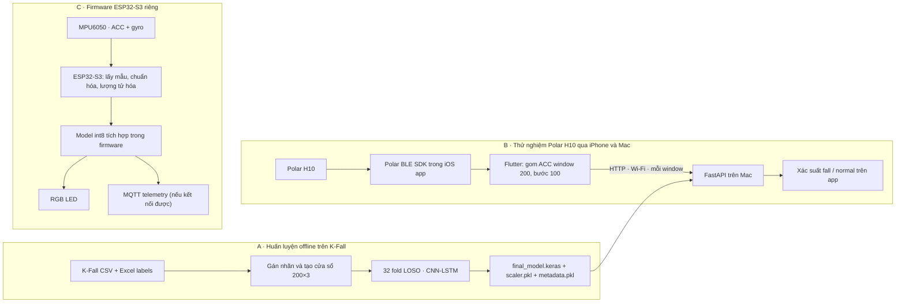

# Hệ thống phát hiện té ngã

Project gồm pipeline huấn luyện và đánh giá CNN-LSTM trên K-Fall, ứng dụng iPhone đọc gia tốc từ Polar H10 để gửi lên Mac dự đoán, cùng một bản firmware chạy model nhúng trên ESP32-S3. Đây là **ba luồng liên quan nhưng độc lập**: model Keras dùng cho app/server; firmware có model, scaler và cách tiền xử lý riêng.

Nếu mới mở project, nên đọc README này trước, sau đó đi theo pipeline tương ứng:

1. Muốn hiểu cách tạo dữ liệu và đánh giá model: đọc [LOSO notebook](model_cnn_lstm_loso.ipynb).
2. Muốn chạy dự đoán với Polar H10 qua iPhone và Mac: đọc phần [ứng dụng và server](#5-ứng-dụng-iphone--polar-h10--fastapi).
3. Muốn chạy hệ thống độc lập trên phần cứng: đọc phần [ESP32-S3](#7-firmware-esp32-s3--mpu6050).

## 1. Sơ đồ toàn hệ thống



Luồng B dùng `final_model.keras`, scaler và metadata đã xuất ở luồng A. Luồng C **không** nạp các file Keras đó; model TFLite/C, scaler, số feature và preprocessing của firmware là bộ riêng. Thay model ở một luồng không tự cập nhật hai luồng còn lại.

## 2. Cấu trúc repository

```text
.
├── model_cnn_lstm_loso.ipynb       # Pipeline chính: 32 fold LOSO và train model cuối
├── model_cnn_lstm.ipynb            # Thử nghiệm đối chứng, split cố định, không augmentation
├── kfall/
│   ├── label_data_new/             # 32 file nhãn SAxx_label.xlsx
│   └── sensor_data_new/            # CSV cảm biến theo subject (dữ liệu local)
├── saved_models_cnn_lstm/          # Checkpoint, model cuối, scaler và metadata
├── polar_h10_receiver/             # Receiver UDP Polar + inference Keras độc lập
├── server/                         # FastAPI: nhận window từ app iPhone, gọi predictor
├── apps/polar_fall_app/             # Flutter UI + iOS bridge vào Polar BLE SDK
├── esp32s3-tinyml-fall-detector/    # Firmware riêng cho ESP32-S3 và MPU6050
├── fall_detection_pcb/              # Schematic, PCB, footprint và PDF KiCad
├── pycore/                          # Tiện ích Python/TikZ vẽ sơ đồ kiến trúc mạng
├── doc/                             # Tài liệu tham khảo local
```

CSV sensor bị Git ignore, vì vậy một clone mới cần được bổ sung dữ liệu local. `esp32s3-tinyml-fall-detector` là repository con được parent ghi bằng gitlink; hiện không có `.gitmodules` để tự tải submodule theo lệnh chuẩn. Thư mục Polar SDK cũng là repository riêng, nằm cạnh repository này trong `AI Projects/`.

## 3. Pipeline huấn luyện từ K-Fall

Nguồn chính thức để hiểu protocol là [model_cnn_lstm_loso.ipynb](model_cnn_lstm_loso.ipynb). Notebook [model_cnn_lstm.ipynb](model_cnn_lstm.ipynb) là thí nghiệm đối chứng split cố định, không phải kết quả LOSO.

### 3.1 Chuẩn bị và gán nhãn dữ liệu

Cấu trúc notebook mong đợi:

```text
kfall/
├── label_data_new/
│   ├── SA06_label.xlsx
│   └── ...
└── sensor_data_new/
    ├── SA06/
    │   ├── S06T01R01.csv
    │   └── ...
    └── ...
```

- Notebook đọc nhãn Excel với cột `Task Code (Task ID)`, `Trial ID`, `Fall_onset_frame`, `Fall_impact_frame`. `Task Code` có ô trống được forward-fill.
- Khóa tra nhãn là `(subject, task_id, trial_id)`. Tên CSV phải theo mẫu `SxxTxxRxx.csv`; các cột cần có là `FrameCounter`, `AccX`, `AccY`, `AccZ`.
- Dữ liệu được dùng theo thứ tự dòng trong CSV. Không sắp xếp lại hoặc nối các recording thành một chuỗi.
- K-Fall trong pipeline này dùng gia tốc theo đơn vị `g` ở 100 Hz. Notebook không resample hay đổi đơn vị.
- Frame từ `Fall_onset_frame` đến `Fall_impact_frame`, **tính cả hai đầu mút**, được gán là frame ngã. Một recording không có khóa trong bảng nhãn được xem là bình thường; cần bảo đảm có đủ file nhãn để tránh gán thiếu ca ngã.
- Danh sách subject lấy từ thư mục `SA*`. Bộ dữ liệu dự kiến có 32 subject: SA06–SA38, không có SA34.

CSV không được lưu trong Git. Nhãn Excel và checkpoint hiện có trong repository; dữ liệu sensor phải tự chuẩn bị trên máy chạy notebook.

### 3.2 Window, nhãn và scaler

| Tham số | Giá trị LOSO |
|---|---|
| Feature, theo thứ tự | `AccX, AccY, AccZ` |
| Kích thước window | 200 mẫu ≈ 2 giây |
| Bước giữa hai window | 100 mẫu ≈ 1 giây; chồng lấp 50% |
| Nhãn Fall của window | Ít nhất 20% trong 200 frame thuộc khoảng onset–impact |
| Dạng input | `(batch, 200, 3)` |
| Đầu ra | Sigmoid probability cho lớp Fall |
| Ngưỡng quyết định | `score >= 0.50` → Fall |

Window được trượt riêng trong từng CSV. Recording ngắn hơn 200 mẫu không sinh window; đoạn dư cuối không đủ một window bị bỏ qua. Các window của subject được giữ trong RAM để tái sử dụng qua các fold.

Trong từng fold, `StandardScaler` được fit trên window gốc của **29 subject train** sau khi gộp các mẫu theo feature. Scaler đó transform train, train augmentation, validation và test. Scaler không fit lên hai subject validation hay subject test.

### 3.3 Augmentation và CNN-LSTM

LOSO tạo một bản sao augmentation cho mỗi window train gốc rồi ghép lại, giữ nguyên nhãn. Jitter, scaling và rotation được chọn độc lập trên từng bản sao, mỗi phép có xác suất 0.10:

| Phép | Cấu hình |
|---|---|
| Jitter | Gaussian noise, mean 0, sigma 0.05 |
| Scaling | Một hệ số chung cho XYZ, Gaussian mean 1, sigma 0.10 |
| Rotation | Góc ngẫu nhiên ±10° quanh ba trục |

Augmentation xảy ra trước khi scale và chỉ trên train. Validation/test không augmentation.

```text
Input (200, 3)
 → Conv1D(32, kernel=5, same) → BatchNorm → ReLU → MaxPool(2) → Dropout(0.2)
 → Conv1D(64, kernel=3, same) → BatchNorm → ReLU → MaxPool(2) → Dropout(0.2)
 → LSTM(64, dropout=0.2)
 → Dense(32, ReLU) → Dropout(0.3)
 → Dense(1, sigmoid)
```

Loss là `binary_crossentropy`, optimizer Adam với learning rate khởi đầu `1e-3`. `class_weight` cân bằng Fall/Normal theo `N / (2 × N_class)`.

### 3.4 Cross-validation LOSO

Notebook chạy 32 fold. Với từng subject lần lượt được giữ làm test:

1. Một subject làm test độc lập.
2. Hai subject trong 31 subject còn lại được chọn xoay vòng làm validation.
3. Hai mươi chín subject còn lại dùng để train và fit scaler.
4. Khởi tạo model mới, huấn luyện tối đa 50 epoch.
5. Tải checkpoint tốt nhất và tính dự đoán trên subject test ở threshold cố định 0.50.

Do đó mỗi fold là **29 train + 2 validation + 1 test**, và mỗi người làm test đúng một lần. Đây là LOSO với validation tách theo subject, không phải nested LOSO để chọn hyperparameter.

| Callback / thiết lập | Cấu hình |
|---|---|
| Batch size | 32 |
| `ModelCheckpoint` | Theo dõi `val_recall`, lưu checkpoint có recall cao nhất |
| `EarlyStopping` | Theo dõi `val_recall`, patience 12, `min_delta=1e-3`, restore best weights |
| `ReduceLROnPlateau` | Theo dõi `val_loss`, patience 3, factor 0.5, min LR `1e-5` |
| Test threshold | 0.50; không tìm threshold trên test |

Checkpoint có tên `saved_models_cnn_lstm/best_model_SAxx.keras`. Code không đặt seed cố định cho từng fold, nên chạy train lại có thể cho kết quả khác. Checkpoint theo `ModelCheckpoint` cũng có thể khác weights được `EarlyStopping` restore vào cuối training; code đánh giá tải checkpoint đã lưu.

### 3.5 Đọc kết quả và đánh giá checkpoint đã lưu

Phần tổng hợp của notebook tính Accuracy, Precision, Recall, F1, F2, ROC-AUC và TN/FP/FN/TP theo từng subject test, sau đó vẽ confusion matrix và báo cáo tổng hợp. ROC-AUC là NaN khi fold test chỉ có một lớp. Trung bình theo subject khác với metric gộp theo toàn bộ window; các chỉ số này đo window, không trực tiếp biểu thị số sự kiện ngã tìm được hay báo động giả mỗi giờ.

Cell mang tiêu đề **“7. Đánh giá từ 32 checkpoint Keras…”** có thể đánh giá model đã lưu mà không train lại. Cell đó dựng lại scaler của từng fold từ window train gốc của đúng 29 subject, rồi nạp `best_model_SAxx.keras`. Vì vậy nó cần giữ nguyên dataset, thứ tự subject, feature, window và cách chia fold. `scaler.pkl` trong thư mục model là scaler của model cuối, **không dùng thay scaler từng fold**.

Working copy hiện tại đã có output của cell đánh giá 32 checkpoint. Bảng dưới là **trung bình và độ lệch chuẩn giữa 32 subject test**, ở ngưỡng 0.50:

| Metric trên lớp Fall | Mean ± Std |
|---|---:|
| Accuracy | 0.9773 ± 0.0084 |
| Precision | 0.8731 ± 0.0457 |
| Recall | 0.9840 ± 0.0123 |
| F1 | 0.9246 ± 0.0275 |
| F2 | 0.9592 ± 0.0157 |
| ROC-AUC | 0.9977 ± 0.0019 |

Gộp 32 test fold thành 32,365 window: **TN=27,147, FP=661, FN=73, TP=4,484**. Đây là metric window-level, không phải số sự kiện ngã hoặc số lần báo động giả trong một giờ. Output này tồn tại trong notebook ở working copy; bản notebook tại Git `HEAD` hiện chưa có output. Giữ notebook có output cùng code/dữ liệu/checkpoint nếu muốn người khác kiểm tra lại các con số. Không dùng các metric này để khẳng định chất lượng trên Polar: chúng được tính trên K-Fall.

### 3.6 Huấn luyện model cuối để inference

Cell cuối của LOSO notebook tạo bộ model dùng cho receiver và FastAPI qua hai pha:

1. Ghép dữ liệu của đủ 32 subject, fit scaler trên toàn bộ window gốc, augmentation train và xáo trộn dữ liệu. Dùng 10% window cuối sau xáo trộn làm validation nội bộ, tối đa 100 epoch; callback theo `val_recall` và `val_loss` chọn epoch.
2. Khởi tạo CNN-LSTM mới và train lại trên toàn bộ dữ liệu gốc cộng augmentation đến epoch đã chọn. Pha này không giữ validation.

Validation ở pha chọn epoch là split **theo window**, sau khi scaler đã fit trên toàn bộ 32 subject và sau augmentation. Các window chồng lấp và bản gốc/bản augmentation tương ứng có thể nằm hai phía của split. Vì vậy đây là tín hiệu chọn epoch, không phải đánh giá độc lập theo người. Giá trị `selected_val_recall` trong metadata không phải Recall LOSO.

### 3.7 Artifacts model

Các file được inference dùng phải cùng một lần export:

| Artifact | Ý nghĩa |
|---|---|
| `final_model.keras` | CNN-LSTM train lại trên toàn bộ 32 subject; model của receiver/API |
| `scaler.pkl` | `StandardScaler` fit trên window gốc của toàn bộ 32 subject |
| `metadata.pkl` | Feature order, kích thước/bước window, threshold, subject và cấu hình train |
| `final_selection_best.keras` | Checkpoint pha chọn epoch, không phải model cuối train lại |
| `best_model_SAxx.keras` | Checkpoint fold test trên subject SAxx |
| `best_model_noaug.keras`, `best_model.keras` | Artifacts của thí nghiệm cũ/đối chứng; không thay thế bộ final |

Metadata đang có ghi `AccX/AccY/AccZ`, window 200, step 100, threshold 0.50, 32 subject, augmentation bật, `selected_epoch=13`, `selected_val_recall≈0.996633`. Đó là log lựa chọn epoch của lần export tương ứng, không phải metric test độc lập. Khi thay model, scaler hoặc metadata, hãy xuất và dùng chúng như một bộ đồng bộ.

## 4. Notebook đối chứng không augmentation

`model_cnn_lstm.ipynb` dùng sáu subject test cố định `SA21, SA23, SA24, SA26, SA30, SA33`. Seed 42 chọn năm subject validation trong 26 subject còn lại; 21 subject cuối cùng dùng train. Notebook không augmentation, fit scaler trên train, train tối đa 100 epoch và dùng validation để chọn checkpoint/early stopping. Tập test chỉ được dùng để báo cáo cuối. Đây là thí nghiệm đối chứng, không phải protocol 32-fold LOSO.

## 5. Ứng dụng iPhone + Polar H10 + FastAPI

Đây là luồng thử nghiệm trực tiếp dùng model Keras final. Polar H10 gửi cảm biến qua BLE cho iPhone; app chuyển các window qua Wi-Fi tới FastAPI trên Mac. iPhone và Mac phải truy cập được nhau trong mạng nội bộ.

```text
Polar H10 --BLE--> Polar SDK (Swift) --EventChannel--> Flutter
   Flutter gom 200 mẫu, gửi lại mỗi 100 mẫu qua HTTP POST /predict
       --> FastAPI trên Mac --> final_model.keras + scaler.pkl + metadata.pkl
       <-- label, probability, threshold
```

### 5.1 Vị trí code

| Thành phần | File |
|---|---|
| Màn hình, nút scan/connect/start/stop, quản lý trạng thái | `apps/polar_fall_app/lib/main.dart` |
| Buffer 200 mẫu, step 100 | `apps/polar_fall_app/lib/window_buffer.dart` |
| POST `/predict`, API key header, parse kết quả | `apps/polar_fall_app/lib/fall_api.dart` |
| Swift bridge gọi BLE SDK Polar | `apps/polar_fall_app/ios/Runner/PolarBridge.swift` |
| FastAPI và kiểm tra request | `server/app.py` |
| Predictor/preprocessing dùng chung với UDP receiver | `polar_h10_receiver/udp_acc_receiver.py` |

iOS target liên kết repository SDK nằm cạnh project tại `AI Projects/polar-ble-sdk` (đường dẫn package `../../../../polar-ble-sdk` tính từ thư mục `ios/`), dùng Swift Package Manager và API Swift Concurrency. App hiện gọi **chỉ ACC**; dù Polar SDK có API ECG, Flutter bridge/UI hiện chưa triển khai đọc ECG. Android cũng chưa có native bridge. README của app ghi commit SDK cần dùng trên máy khác: `3d15da61dd0c63e6be2582d03fd80f6c7ba02e11`.

### 5.2 Xử lý tín hiệu và API

- App đọc ACC XYZ của Polar, giá trị nguyên đơn vị milli-g có bao gồm trọng lực, kèm timestamp truyền dưới dạng chuỗi.
- App truy vấn setting thiết bị, ưu tiên 100 Hz nếu được hỗ trợ. App chỉ gửi dữ liệu cho model khi sample rate là 100 Hz; server kiểm tra đúng 200 mẫu và cadence xấp xỉ 10 ms (dung sai ±20%).
- Buffer phát window 1–200, 101–300, 201–400…; buffer reset khi bắt đầu/dừng phiên hoặc mất kết nối. Dữ liệu không được lưu lâu dài.
- Receiver/server đổi milli-g sang g và map trục theo `(Polar Y, -Polar X, -Polar Z)`, sau đó dùng `scaler.pkl` đã fit. Không fit scaler hoặc augmentation khi inference.
- Server khởi tạo `FallPredictor` một lần, khóa bằng `FALL_API_KEY`, rồi nhận `POST /predict` kèm `X-API-Key`. Mỗi lần trả label, xác suất, threshold, thời gian inference và timestamp cuối.
- Chỉ Mac chạy API; địa chỉ trong app phải là IP Mac truy cập được từ iPhone, không phải `localhost`. Nếu đổi Wi-Fi/hotspot, kiểm tra lại IP và sửa `local_config.json`.

Mapping trục hiện được giữ từ receiver thử nghiệm; hướng đeo Polar, dấu trục Z, vị trí cảm biến và khác biệt với dữ liệu K-Fall cần được xác nhận bằng dữ liệu thực. Kết quả K-Fall không tự chứng minh độ chính xác trên người đeo Polar.

HTTP và khóa dùng chung chỉ phục vụ demo mạng nội bộ; khóa trong app có thể bị trích từ build và HTTP không mã hóa nội dung. Không đưa API ra Internet. Kết quả là dự đoán nghiên cứu, chưa phải cảnh báo khẩn cấp đã được kiểm định.

### 5.3 Chạy server trên Mac

Trên máy hiện tại `.venv` nằm ở `AI Projects/.venv`, tức **cạnh** repository. Mở terminal tại gốc repository:

```bash
cd "/path/to/AI Projects/fall-detection-sic-capstone"
export FALL_API_KEY='your-local-random-key'
../.venv/bin/python -m uvicorn server.app:app --host 0.0.0.0 --port 8000
```

`FALL_API_KEY` phải dài tối thiểu 16 ký tự và trùng với giá trị trong `apps/polar_fall_app/local_config.json`. Giữ terminal mở. Có thể kiểm tra Mac bằng:

```bash
curl http://127.0.0.1:8000/health
ipconfig getifaddr en0
```

Health mong đợi `status=ready`, `window_size=200`, `window_step=100`, `sample_rate_hz=100`. Thử mở `http://<mac-ip>:8000/health` trên iPhone để xác nhận mạng. Nếu cài dependencies cho server:

```bash
../.venv/bin/python -m pip install -r server/requirements.txt
```

### 5.4 Cấu hình và chạy app

Tạo `apps/polar_fall_app/local_config.json` từ file mẫu nếu chưa có; đặt `FALL_API_URL` thành `http://<mac-ip>:8000` và `FALL_API_KEY` thành đúng key server. File local này được ignore bởi Git.

Từ thư mục `apps/polar_fall_app`:

```bash
export DEVELOPER_DIR=/Applications/Xcode.app/Contents/Developer
/Users/bach/flutter/bin/flutter pub get
/Users/bach/flutter/bin/flutter devices
/Users/bach/flutter/bin/flutter run -d <iphone-device-id> --dart-define-from-file=local_config.json
```

Log chạy Flutter trước đây trên Mac báo `iOS 26.5 is not installed`. Nếu lỗi này xuất hiện lại, kiểm tra iOS platform/support ở Xcode → Settings → Components/Platforms và cài khi có Wi-Fi. Lệnh tải platform từng hiện gói iOS Simulator 8.52 GB; đã hủy khi máy đang dùng 4G.

SDK path ở dòng Flutter là path của máy hiện tại; thay bằng vị trí Flutter SDK của máy khác. iOS deployment target của app là iOS 15. Chọn Team trong Xcode → Runner → Signing & Capabilities, cho phép Bluetooth và Local Network khi iPhone hỏi. Sau đó quét Polar, kết nối, đợi trạng thái ready rồi bấm **Bắt đầu ACC**. Bắt đầu thử khi app còn foreground.

Widget preview trong VS Code dùng dữ liệu tổng hợp, chỉ xem được UI; nó không kiểm thử BLE, mạng hoặc model thật.

### 5.5 Receiver UDP độc lập

`polar_h10_receiver/udp_acc_receiver.py` có thể chạy độc lập khi một sender khác phát UDP đến cổng 5005. Định dạng mỗi mẫu là `timestamp,x_mg,y_mg,z_mg`; mặc định receiver đếm frame ở 100 Hz. Chạy từ gốc repository:

```bash
../.venv/bin/python polar_h10_receiver/udp_acc_receiver.py --check-model
../.venv/bin/python polar_h10_receiver/udp_acc_receiver.py
```

`--check-model` nạp và warm-up bộ artifacts, không mở UDP. Khi biết chắc đơn vị timestamp, có thể thêm `--timestamp-unit ns` (hoặc `us`, `ms`) để kiểm tra cadence và reset khi mất mẫu. Receiver cũng dùng model/scaler/metadata final, nhưng đây là đường nhận UDP riêng; app iPhone hiện gửi HTTP đến FastAPI chứ không gửi UDP đến receiver này.

## 6. Đánh giá giới hạn inference

- Các metric notebook tính trên **window**. Một cú ngã sinh nhiều window chồng lấp, vì vậy số window dự đoán đúng không tương đương số sự kiện ngã được phát hiện.
- Accuracy/Recall từ validation dùng để chọn model hoặc epoch không phải kết quả test độc lập.
- Chưa có bảng kết quả LOSO được lưu cùng notebook; hãy chạy cell tổng hợp bằng đúng dataset và checkpoint trước khi báo cáo số liệu.
- Model final được huấn luyện trên các subject K-Fall. Tín hiệu Polar cần kiểm tra đơn vị, trục, sampling rate, vị trí đeo và hiệu chỉnh trên thiết bị thực.
- UI hiển thị dự đoán của model. Dự án hiện chưa lưu lịch sử, gửi báo động khẩn cấp hoặc xác nhận fall event theo thời gian.

## 7. Firmware ESP32-S3 + MPU6050

Đây là luồng edge riêng, không dùng Flutter, Polar SDK, FastAPI hay model Keras final. Firmware đọc ACC + gyro MPU6050, chạy TensorFlow Lite Micro, báo trạng thái bằng WS2812 và có thể gửi telemetry qua MQTT.

Trong **working tree local hiện tại**, model nhúng đã được sửa thành input INT8 `(200, 6)` với feature `[AccX, AccY, AccZ, GyrX, GyrY, GyrZ]`, bước dự đoán 50 mẫu và threshold 0.50. Nhưng gitlink của parent repository trỏ tới revision `2a9be436076fb1deef15c532e0309c0634015c40`, nơi cấu hình lưu trong Git là 8 feature, step 100, threshold 0.55. Các file model/scaler/runtime và host-check trong firmware hiện có thay đổi local chưa commit. Vì hai trạng thái không giống nhau, hãy kiểm tra `git -C esp32s3-tinyml-fall-detector status` và quyết định revision/model cần dùng trước khi build hoặc flash; đừng coi model firmware hiện tại là model Keras final.

Luồng firmware hiện tại lấy mẫu MPU6050 ở 100 Hz trên Core 0, đẩy qua queue cho Core 1. Model window kiểm tra sequence/timestamp, chuẩn hóa và lượng tử hóa theo các hằng số nhúng trong `main/model/scaler_data.h`. Khi có dự đoán, WS2812 hiển thị normal/fall; Wi-Fi/MQTT gửi kết quả nếu broker sẵn sàng. Lỗi I2C, sample gap, dữ liệu không hữu hạn hoặc model chậm sẽ reset window và báo lỗi. Mất mạng không dừng inference tại board.

Thiết lập mặc định trong workspace: SDA GPIO 8, SCL GPIO 9, I2C 400 kHz; chân LED RGB GPIO 48 là thiết lập provisional và cần khớp board revision. Đặt Wi-Fi SSID/password và MQTT broker IP bằng `idf.py menuconfig`; file `sdkconfig.defaults` chỉ chứa placeholder. README trong thư mục firmware có chi tiết wiring, ESP-IDF, Mosquitto và lệnh build/flash.

## 8. PCB và phần cứng

`fall_detection_pcb/` chứa schematic, board KiCad, footprint header/ESP32-S3 và một số PDF lớp mạch. Thiết kế nhắm đến ESP32-S3 cùng header cho MPU6050/nguồn. Đối chiếu schematic, footprint, bo mạch thực và cấu hình GPIO trước khi chế tạo; tài liệu PCB hiện không phải bằng chứng đã kiểm định điện hay độ an toàn của thiết bị.

## 9. Môi trường làm việc và điểm bắt đầu

Các bước sau giả định dữ liệu K-Fall đã có tại `kfall/sensor_data_new` và `kfall/label_data_new`.

```bash
# Từ gốc repository trên máy hiện tại; .venv ở thư mục cha
source ../.venv/bin/activate
python -m pip install tensorflow numpy pandas scikit-learn matplotlib joblib openpyxl jupyterlab
python -m jupyter lab
```

Mở `model_cnn_lstm_loso.ipynb`, đặt working directory là gốc repository và chạy theo thứ tự:

1. Import và đọc 32 file nhãn.
2. Cấu hình subject, feature và window.
3. Đọc CSV, tạo và cache window của từng subject.
4. Khai báo augmentation và model.
5. Chạy cell train LOSO nếu cần train mới; cell này ghi checkpoint `best_model_SAxx.keras`.
6. Hoặc, nếu checkpoint được train theo đúng split hiện tại, chạy cell có tiêu đề mục 7 để đánh giá mà không train lại.
7. Sau khi protocol đánh giá đã chốt, chạy cell cuối để chọn epoch và xuất bộ model final dùng cho inference.

Lần đầu chạy 32 fold có thể tốn nhiều thời gian/bộ nhớ. Chạy lại cell train/final sẽ ghi đè artifacts cùng tên trong `saved_models_cnn_lstm/`; giữ bản cần dùng trước khi tái huấn luyện.

Nếu tạo môi trường mới ngay trong repository thay vì dùng `.venv` ở thư mục cha:

```bash
python3 -m venv .venv
source .venv/bin/activate
python -m pip install tensorflow numpy pandas scikit-learn matplotlib joblib openpyxl jupyterlab
```

Chưa có lockfile Python cho notebook. `server/requirements.txt` pin TensorFlow và một số gói phục vụ API, nhưng không khóa toàn bộ môi trường nghiên cứu. Để tái lập training chặt chẽ, hãy ghi phiên bản Python/thư viện cùng dữ liệu, seed và notebook output của lần chạy.

## 10. Kiểm tra code

Flutter:

```bash
cd apps/polar_fall_app
/Users/bach/flutter/bin/flutter analyze
/Users/bach/flutter/bin/flutter test
```

Server và receiver (từ gốc repository; kiểm tra này nạp model thật):

```bash
../.venv/bin/python -m unittest server.test_app -v
../.venv/bin/python -m unittest discover -s polar_h10_receiver -v
```

Host check firmware được mô tả trong `esp32s3-tinyml-fall-detector/README.md`; firmware test cần managed TFLite Micro components đã tải bởi ESP-IDF.
